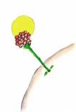
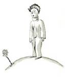
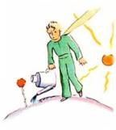
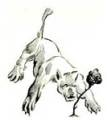
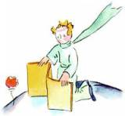
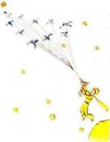
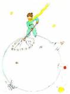
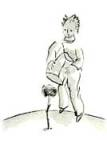
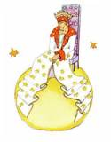

# 20260830

From *The Little Prince*, by Antoine de Saint-Exupéry, Translated by Katherine Woods

## Chapter VII

On the fifth day—again, as always, it was thanks to the sheep—the secret of the little prince's life was revealed to me. Abruptly, without anything to lead up to[^1] it, and as if the question had been born of long and silent meditation on his problem, he demanded:

"A sheep—if it eats little bushes, does it eat flowers, too?"

"A sheep," I answered, "eats anything it finds in its reach[^2]."

"Even flowers that have thorns[^3]?"

"Yes, even flowers that have thorns."

"Then the thorns—what use are they?"

I did not know. At that moment I was very busy trying to unscrew a bolt that had got stuck in my engine. I was very much worried, for it was becoming clear to me that the breakdown of my plane was extremely serious. And I had so little drinking water left that I had to fear for the worst.

"The thorns—what use are they?"

The little prince never let go of a question, once he had asked it. As for me, I was upset over that bolt. And I answered with the first thing that came into my head:

"The thorns are of no use at all. Flowers have thorns just for spite[^4]!"

"Oh!"

There was a moment of complete silence. Then the little prince flashed[^5] back at me, with a kind of resentfulness[^6]:

"I don't believe you! Flowers are weak creatures. They are naive. They reassure[^7] themselves as best they can. They believe that their thorns are terrible weapons..."

I did not answer. At that instant I was saying to myself: "If this bolt still won't turn[^8], I am going to knock it out with the hammer." Again the little prince disturbed my thoughts.

"And you actually believe that the flowers—"

"Oh, no!" I cried. "No, no no! I don't believe anything. I answered you with the first thing that came into my head. Don't you see—I am very busy with matters of consequence!"

He stared at me, thunderstruck[^9].

"Matters of consequence!"

He looked at me there, with my hammer in my hand, my fingers black with engine-grease, bending down over an object, which seemed to him extremely ugly...

"You talk just like the grown-ups!"

That made me a little ashamed. But he went on, relentlessly[^10]:

"You mix[^11] everything up together... You confuse everything..."

He was really very angry. He tossed his golden curls[^12] in the breeze[^13].

"I know a planet where there is a certain red-faced gentleman. He has never smelled a flower. He has never looked at a star. He has never loved any one. He has never done anything in his life but add up figures. And all day he says over and over, just like you: 'I am busy with matters of consequence!' And that makes him swell up with pride. But he is not a man—he is a mushroom!"

"A what?"

"A mushroom!"

The little prince was now white with rage.

"The flowers have been growing thorns for millions of years. For millions of years the sheep have been eating them just the same. And is it not a matter of consequence to try to understand why the flowers go to so much trouble to grow thorns, which are never of any use to them? Is the warfare[^14] between the sheep and the flowers not important? Is this not of more consequence than a fat red-faced gentleman's sums? And if I know—I, myself—one flower which is unique in the world, which grows nowhere but on my planet, but which one little sheep can destroy in a single bite some morning, without even noticing what he is doing—Oh! You think that is not important!"

His face turned from white to red as he continued:

"If some one loves a flower, of which just one single blossom[^15] grows in all the millions and millions of stars, it is enough to make him happy just to look at the stars. He can say to himself, 'Somewhere, my flower is there...' But if the sheep eats the flower, in one moment all his stars will be darkened... And you think that is not important!" He could not say anything more. His words were choked by sobbing.

The night had fallen. I had let my tools drop from my hands. Of what moment now was my hammer, my bolt, or thirst, or death? On one star, one planet, my planet, the Earth, there was a little prince to be comforted. I took him in my arms, and rocked[^16] him. I said to him:

"The flower that you love is not in danger. I will draw you a muzzle[^17] for your sheep. I will draw you a railing[^18] to put around your flower. I will—"

I did not know what to say to him. I felt awkward and blundering[^19]. I did not know how I could reach him, where I could overtake[^20] him and go on hand in hand with him once more[^21].

It is such a secret place, the land of tears.

## Chapter VIII

I soon learned to know this flower better. On the little prince's planet the flowers had always been very simple. They had only one ring of petals[^22]; they took up no room at all; they were a trouble to nobody. One morning they would appear in the grass, and by night they would have faded peacefully away. But one day, from a seed blown from no one knew where, a new flower had come up; and the little prince had watched very closely over this small sprout which was not like any other small sprouts on his planet. It might, you see, have been a new kind of baobab.

The shrub[^23] soon stopped growing, and began to get ready to produce a flower. The little prince, who was present at the first appearance of a huge bud, felt at once that some sort of miraculous apparition must emerge from it. But the flower was not satisfied to complete the preparations for her beauty in the shelter of her green chamber[^24]. She chose her colours with the greatest care. She adjusted her petals one by one. She did not wish to go out into the world all rumpled[^25], like the field poppies[^26]. It was only in the full radiance[^27] of her beauty that she wished to appear. Oh, yes! She was a coquettish[^28] creature! And her mysterious adornment[^29] lasted for days and days.

Then one morning, exactly at sunrise, she suddenly showed herself.

And, after working with all this painstaking precision, she yawned and said:

"Ah! I am scarcely[^30] awake. I beg that you will excuse me. My petals are still all disarranged[^31]..."

But the little prince could not restrain[^32] his admiration:

"Oh! How beautiful you are!"

"Am I not?" the flower responded, sweetly. "And I was born at the same moment as the sun..."

The little prince could guess easily enough that she was not any too modest—but how moving—and exciting—she was!

"I think it is time for breakfast," she added an instant later. "If you would have the kindness to think of my needs—"

And the little prince, completely abashed[^33], went to look for a sprinkling[^34]-can of fresh water. So, he tended the flower.

So, too, she began very quickly to torment[^35] him with her vanity[^36]—which was, if the truth be known, a little difficult to deal with. One day, for instance, when she was speaking of her four thorns, she said to the little prince:

"Let the tigers come with their claws!"

"There are no tigers on my planet," the little prince objected. "And, anyway, tigers do not eat weeds[^37]."

"I am not a weed," the flower replied, sweetly.

"Please excuse me..."

"I am not at all afraid of tigers," she went on, "but I have a horror[^38] of drafts[^39]. I suppose you wouldn't have a screen[^40] for me?"

"A horror of drafts—that is bad luck, for a plant," remarked the little prince, and added to himself, "This flower is a very complex creature..."

"At night I want you to put me under a glass globe. It is very cold where you live. In the place I came from—"

But she interrupted herself at that point. She had come in the form of a seed. She could not have known anything of any other worlds. Embarrassed over having let herself be caught on the verge[^41] of such a naïve untruth, she coughed two or three times, in order to put the little prince in the wrong[^42].

"The screen?"

"I was just going to look for it when you spoke to me..."

Then she forced her cough a little more so that he should suffer from remorse[^43] just the same.

So the little prince, in spite of all the good will that was inseparable from his love, had soon come to doubt her. He had taken seriously words, which were without importance, and it made him very unhappy.

"I ought not to have listened to her," he confided[^44] to me one day. "One never ought to listen to the flowers. One should simply look at them and breathe their fragrance. Mine perfumed[^45] all my planet. But I did not know how to take pleasure in all her grace[^46]. This tale of claws, which disturbed me so much, should only have filled my heart with tenderness and pity."

And he continued his confidences[^47]:

"The fact is that I did not know how to understand anything! I ought to have judged by deeds and not by words. She cast her fragrance and her radiance over me. I ought never to have run away from her... I ought to have guessed all the affection that lay behind her poor little stratagems[^48]. Flowers are so inconsistent! But I was too young to know how to love her..."

## Chapter IX

I believe that for his escape he took advantage of the migration of a flock of wild birds. On the morning of his departure he put his planet in perfect order. He carefully cleaned out his active volcanoes. He possessed two active volcanoes; and they were very convenient for heating his breakfast in the morning. He also had one volcano that was extinct. But, as he said, "One never knows!" So he cleaned out the extinct volcano, too. If they are well cleaned out, volcanoes burn slowly and steadily, without any eruptions. Volcanic eruptions are like fires in a chimney[^49].

On our earth we are obviously much too small to clean out our volcanoes. That is why they bring no end of[^50] trouble upon us.

The little prince also pulled up, with a certain sense of dejection[^51], the last little shoots[^52] of the baobabs. He believed that he would never want to return. But on this last morning all these familiar tasks seemed very precious to him. And when he watered the flower for the last time, and prepared to place her under the shelter of her glass globe, he realised that he was very close to tears.

"Goodbye," he said to the flower.

But she made no answer.

"Goodbye," he said again.

The flower coughed. But it was not because she had a cold.

"I have been silly," she said to him, at last. "I ask your forgiveness. Try to be happy..."

He was surprised by this absence of reproaches[^53]. He stood there all bewildered[^54], the glass globe held arrested in mid-air. He did not understand this quiet sweetness.

"Of course I love you," the flower said to him. "It is my fault that you have not known it all the while. That is of no importance. But you—you have been just as foolish as I. Try to be happy... let the glass globe be. I don't want it any more."

"But the wind—"

"My cold is not so bad as all that... the cool night air will do me good. I am a flower."

"But the animals—"

"Well, I must endure the presence of two or three caterpillars[^55] if I wish to become acquainted with the butterflies. It seems that they are very beautiful. And if not the butterflies—and the caterpillars—who will call upon me? You will be far away... as for the large animals—I am not at all afraid of any of them. I have my claws."

And, naïvely, she showed her four thorns. Then she added:

"Don't linger[^56] like this. You have decided to go away. Now go!"

For she did not want him to see her crying. She was such a proud flower...

## Chapter X

He found himself in the neighbourhood of the asteroids 325, 326, 327, 328, 329, and 330. He began, therefore, by visiting them, in order to add to his knowledge.

The first of them was inhabited by a king. Clad[^57] in royal purple and ermine[^58], he was seated upon a throne[^59] which was at the same time both simple and majestic[^60].

"Ah! Here is a subject," exclaimed the king, when he saw the little prince coming.

And the little prince asked himself:

"How could he recognize me when he had never seen me before?"

He did not know how the world is simplified for kings. To them, all men are subjects.

"Approach, so that I may see you better," said the king, who felt consumingly[^61] proud of being at last a king over somebody.

The little prince looked everywhere to find a place to sit down; but the entire planet was crammed[^62] and obstructed[^63] by the king's magnificent ermine robe. So he remained standing upright[^64], and, since he was tired, he yawned.

"It is contrary to etiquette[^65] to yawn in the presence of a king," the monarch said to him. "I forbid you to do so."

"I can't help it. I can't stop myself," replied the little prince, thoroughly embarrassed. "I have come on a long journey, and I have had no sleep..."

"Ah, then," the king said. "I order you to yawn. It is years since I have seen anyone yawning. Yawns, to me, are objects of curiosity. Come, now! Yawn again! It is an order."

"That frightens me... I cannot, any more..." murmured the little prince, now completely abashed.

"Hum! Hum!" replied the king. "Then I—I order you sometimes to yawn and sometimes to—"

He sputtered[^66] a little, and seemed vexed[^67].

For what the king fundamentally insisted upon was that his authority should be respected. He tolerated no disobedience. He was an absolute monarch. But, because he was a very good man, he made his orders reasonable.

"If I ordered a general," he would say, by way of example, "if I ordered a general to change himself into a sea bird, and if the general did not obey me, that would not be the fault of the general. It would be my fault."

"May I sit down?" came now a timid[^68] inquiry from the little prince.

"I order you to do so," the king answered him, and majestically[^69] gathered in a fold of his ermine mantle.

But the little prince was wondering... The planet was tiny. Over what could this king really rule?

"Sire[^70]," he said to him, "I beg that you will excuse my asking you a question—"

"I order you to ask me a question," the king hastened[^71] to assure him.

"Sire—over what do you rule?"

"Over everything," said the king, with magnificent simplicity.

"Over everything?"

The king made a gesture, which took in his planet, the other planets, and all the stars.

"Over all that?" asked the little prince.

"Over all that," the king answered.

For his rule was not only absolute: it was also universal.

"And the stars obey you?"

"Certainly they do," the king said. "They obey instantly. I do not permit insubordination[^72]."

Such power was a thing for the little prince to marvel[^73] at. If he had been master of such complete authority, he would have been able to watch the sunset, not forty-four times in one day, but seventy-two, or even a hundred, or even two hundred times, without ever having to move his chair. And because he felt a bit sad as he remembered his little planet, which he had forsaken[^74], he plucked[^75] up his courage to ask the king a favour:

"I should like to see a sunset... do me that kindness... Order the sun to set..."

"If I ordered a general to fly from one flower to another like a butterfly, or to write a tragic drama, or to change himself into a sea bird, and if the general did not carry out the order that he had received, which one of us would be in the wrong?" the king demanded. "The general, or myself?"

"You," said the little prince firmly.

"Exactly. One much require from each one the duty which each one can perform," the king went on. "Accepted authority rests first of all on reason. If you ordered your people to go and throw themselves into the sea, they would rise up[^76] in revolution. I have the right to require obedience because my orders are reasonable."

"Then my sunset?" the little prince reminded him: for he never forgot a question once he had asked it.

"You shall have your sunset. I shall command it. But, according to my science of government, I shall wait until conditions are favourable."

"When will that be?" inquired the little prince.

"Hum! Hum!" replied the king; and before saying anything else he consulted a bulky almanac[^77]. "Hum! Hum! That will be about—about—that will be this evening about twenty minutes to eight. And you will see how well I am obeyed."

The little prince yawned. He was regretting his lost sunset. And then, too, he was already beginning to be a little bored.

"I have nothing more to do here," he said to the king. "So I shall set out on my way again."

"Do not go," said the king, who was very proud of having a subject. "Do not go. I will make you a Minister!"

"Minister of what?"

"Minster of—of Justice!"

"But there is nobody here to judge!"

"We do not know that," the king said to him. "I have not yet made a complete tour of my kingdom. I am very old. There is no room here for a carriage[^78]. And it tires[^79] me to walk."

"Oh, but I have looked already!" said the little prince, turning around to give one more glance to the other side of the planet. On that side, as on this, there was nobody at all...

"Then you shall judge yourself," the king answered. "that is the most difficult thing of all. It is much more difficult to judge oneself than to judge others. If you succeed in judging yourself rightly, then you are indeed a man of true wisdom."

"Yes," said the little prince, "but I can judge myself anywhere. I do not need to live on this planet.

"Hum! Hum!" said the king. "I have good reason to believe that somewhere on my planet there is an old rat. I hear him at night. You can judge this old rat. From time to time[^80] you will condemn him to death. Thus his life will depend on your justice. But you will pardon him on each occasion; for he must be treated thriftily[^81]. He is the only one we have."

"I," replied the little prince, "do not like to condemn anyone to death. And now I think I will go on my way."

"No," said the king.

But the little prince, having now completed his preparations for departure, had no wish to grieve[^82] the old monarch.

"If Your Majesty wishes to be promptly obeyed," he said, "he should be able to give me a reasonable order. He should be able, for example, to order me to be gone by the end of one minute. It seems to me that conditions are favourable..."

As the king made no answer, the little prince hesitated a moment. Then, with a sigh, he took his leave.

"I made you my Ambassador," the king called out, hastily.

He had a magnificent air of authority.

"The grown-ups are very strange," the little prince said to himself, as he continued on his journey.

[^1]: lead up to: to be an introduction to or the cause of something是…的先导；是导致…的原因 the weeks leading up to the exam 临近考试的几个星期 the events leading up to the strike 导致罢工的事件

[^2]: reach: [uncountable, singular] the distance over which you can stretch your arms to touch something; the distance over which a particular object can be used to touch something else手臂展开的长度；臂展 **beyond somebody's reach** The shot was well beyond the reach of the goalkeeper. 这次射门使守门员鞭长莫及。  **out of somebody's reach** Keep all medicines out of reach of children. 把所有的药放到孩子们够不着的地方。 **within somebody's reach** He lashed out angrily, hitting anyone within his reach. 他气急败坏，见人就打。 It's a book I like to keep within arm's reach. 我喜欢把这本书放在触手可及的地方。 Use shears with a long reach for cutting high hedges. 用长柄大剪刀修剪高树篱。 As a boxer, his long reach gives him a significant advantage. 作为拳击运动员，他出拳距离长是他很大的优势。

[^3]: thorn: a small sharp, pointed part on the stem of some plants, such as roses（玫瑰之类植物的）刺，棘刺

[^4]: spite: a feeling of wanting to hurt or upset somebody恶意；怨恨 **synonym** malice **out of spite** I'm sure he only said it out of spite. 我相信他只是为了泄愤才那么说的。

[^5]: flash: [intransitive] (+ adv./prep.) (literary) to show a strong emotion suddenly and quickly突然显露（强烈情感） Her eyes flashed with anger. 她眼中闪出怒火。 Fear flashed in his eyes. 他眼中闪过恐惧。

[^6]: resentful: feeling bitter or angry about something that you think is unfair感到气愤的；憎恨的；愤慨的 a resentful look充满怨恨的眼神 **resentful of/at/about something** They seemed to be resentful of our presence there. 他们好像对我们在那里露面很生气。 She was resentful at having been left out of the team. 她对被运动队淘汰感到气愤。

[^7]: reassure: to say or do something that makes somebody less frightened or worried使…安心；打消…的疑虑 **synonym** put/set somebody’s mind at ease/rest  **reassure somebody (about something)**  They tried to reassure her, but she still felt anxious. 他们设法让她放心，可她还是焦虑不安。  **reassure somebody that…**  The doctor reassured him that there was nothing seriously wrong. 医生安慰他说，没什么大毛病。  **be reassured of something**  She needed to be reassured of his love for her. 她需要证实他是爱她的。

[^8]: turn: [intransitive, transitive] to move or make something move around a central point（使）转动，旋转 The wheels of the car began to turn. 汽车的轮子开始转动起来。 I can't get the screw to turn. 我拧不动这个螺丝钉。  **+ adv./prep.**  The blades of the helicopter were turning slowly.直升机的旋翼在慢速旋转。  **turn something**  I turned the knob and pushed the door open. 我转动把手，把门推开。 **turn something + adv./prep.**  He turned the key in the lock. 他转动钥匙开锁。 She turned the wheel sharply to the left. 她猛地向左打方向盘。

[^9]: thunderstruck: [not usually before noun] extremely surprised and shocked大吃一惊

[^10]: relentlessly: in a way that continues strongly, without stopping, giving up or getting less strong以一种持续不断的方式，而不停止，放弃或变得不那么坚强 The rebels relentlessly pursued the idea of a separate state. 反叛者坚持不懈地追求独立国家的想法。

[^11]: mix something up: to change the order or arrangement of a group of things, especially by mistake or in a way that you do not want弄错；弄乱 **synonym** muddle Someone has mixed up all the application forms. 有人把申请表都弄乱了。 mix somebody/something up (with somebody/something): to think wrongly that somebody/something is somebody/something else误以为…是；弄错；搞错 **synonym** confuse I think you must be mixing me up with someone else. 我觉得你一定是把我错当成别人了。

[^12]: curl: [countable] a small bunch of hair that forms a curved or round shape（一绺(liǔ)）鬈(quán)发 Her hair was a mass of curls. 她满头鬈发。 The baby had dark eyes and dark curls. 那婴孩长着深色的眼睛和深色的鬈发。

[^13]: breeze: [countable] a light wind微风；和风 a sea breeze 柔和的海风 The flowers were gently swaying in the breeze. 花儿在微风中轻轻舞动。 A light breeze was blowing. 轻风习习。

[^14]: warfare: the activity of fighting a war, especially using particular weapons or methods战；作战；战争 air/naval/guerrilla warfare 空战/海战/游击战 countries engaged in warfare 参战国

[^15]: blossom: [countable, uncountable]a flower or a mass of flowers, especially on a fruit tree or bush（尤指果树或灌木的）花朵，花簇 cherry/orange/apple blossom 樱桃花；橘子花；苹果花 The trees are in blossom. 树上鲜花盛开。 She loved the spring, when the blossom was out. 她喜欢春天，那时花开了。

[^16]: rock: [intransitive, transitive] to move gently backwards and forwards or from side to side; to make somebody/something move in this way（使）轻轻摇晃，缓缓摆动 **(+ adv./prep.)**  The boat rocked from side to side in the waves. 小船在波浪中摇荡。 She was rocking backwards and forwards in her seat. 她在座位上前摇后晃。  **rock somebody/something (+ adv./prep.)**  He rocked the baby gently in his arms. 他抱着孩子轻轻摇晃。

[^17]: muzzle: a device made of leather or plastic that you put over the nose and mouth of an animal, especially a dog, to prevent it from biting people（防止动物咬人的）口套，鼻笼

[^18]: railing: [countable, usually plural]a fence made of metal bars that go straight upwards; one of these bars金属围栏；金属栏杆 iron/metal railings 铁/金属栏杆 I chained my bike to the park railings. 我用链子把自行车锁在公园的围栏上了。 She leaned out over the railing. 她靠在栏杆上探出身去。

[^19]: blunder: to make a stupid or careless mistake犯愚蠢的（或粗心的）错误 The government had blundered in its handling of the affair. 政府在这件事的处理上犯了大错。

[^20]: overtake: [transitive, intransitive] overtake (somebody/something) (especially British English) to go past a moving vehicle or person ahead of you because you are going faster than they are超过；赶上 He pulled out to overtake a truck. 他驶出车流，以超过一辆卡车。 It's dangerous to overtake on a bend. 在弯道强行超车是危险的。

[^21]: once again | once more: one more time; another time再一次；再次 Once again the train was late. 火车又一次晚点了。 Let me hear it just once more. 让我再听一遍。

[^22]: petal: a delicate coloured part of a flower. The head of a flower is usually made up of several petals around a central part.花瓣

[^23]: shrub: a large plant that is smaller than a tree and that has several stems of wood coming from the ground灌木 **synonym** bush evergreen shrubs常青灌木 shrub roses木本蔷薇

[^24]: chamber: [countable] (in compounds构成复合词) a room used for the particular purpose that is mentioned（作特定用途的）房间，室 a Bronze Age burial chamber 青铜器时代的墓室

[^25]: rumple: rumple something to make something untidy or not smooth and neat弄皱；弄乱 She rumpled his hair playfully. 她顽皮地弄乱他的头发。 The bed was rumpled where he had slept. 床上他睡过的地方有皱痕。 a rumpled linen suit 皱巴巴的亚麻套装

[^26]: poppy: a wild or garden plant, with a large delicate flower that is usually red, and small black seeds. Opium is obtained from one type of poppy.罂粟 poppy fields/seeds 罂粟田／籽

[^27]: radiance: [uncountable] a special bright quality that shows in somebody’s face, for example because they are very happy or healthy容光焕发；红光满面

[^28]: coquettish/kɒˈketɪʃ//kəʊˈketɪʃ/: (literary, often disapproving) (of a woman's behaviour) intended to attract men卖弄风情的女人 **synonym** flirtatious

[^29]: adornment/əˈdɔːnmənt/: [countable] something that you wear to make yourself look more attractive; something used to decorate a place or an object 装饰：为了使自己看起来更有吸引力而穿的衣服；用于装饰地方或物体的东西 A plain necklace was her only adornment. 她身上的饰物就只有一串简单的项链。

[^30]: scarcely: only just; almost not勉强；刚；几乎不；简直不 I can scarcely believe it. 我几乎不敢相信。 We scarcely ever meet. 我们难得见一面。 Scarcely a week goes by without some new scandal in the papers. 报上几乎周周都会登出新的丑闻。 There was scarcely a tree left standing after the storm. 暴风雨过后，几乎没有一棵树留下来。

[^31]: disarrange: [usually passive] (formal) **disarrange something**: to make something untidy使紊乱；弄乱

[^32]: restrain: to stop yourself from feeling an emotion or doing something that you would like to do约束（自己）；控制（自己）；忍住  **restrain something**  John managed to restrain his anger. 约翰努力压制住自己的怒气。 I restrained the urge to punch him. 我抑制住了自己的冲动，没用拳头打他。  **restrain yourself (from something/from doing something)**  She had to restrain herself from crying out in pain. 她只得忍住疼痛，不哭出来。 I was tempted to answer back, but I restrained myself. 我想还嘴，但忍住了。

[^33]: abashed: [not before noun] embarrassed and ashamed because of something that you have done羞愧；窘迫；尴尬 He glanced at Juliet accusingly and she looked suitably abashed. 他怪罪地一瞥，朱丽叶自然显得很窘。

[^34]: sprinkling (also sprinkle) [usually singular]:  **sprinkling (of something/somebody)**: a small amount of a substance that is dropped somewhere, or a number of things or people that are spread or included somewhere少量（落、撒或包含的某种物质）；少数（分散在或包括在某处的人） Add a sprinkling of pepper. 加一点胡椒粉。 There was a sprinkling of freckles on her cheeks. 她的脸颊上有一些雀斑。 Most were men, but there was also a sprinkling of young women. 多数是男人，不过也有为数不多的年轻妇女。

[^35]: torment/tɔːˈment/:  **torment somebody** (formal): to make somebody suffer very much使备受折磨；使痛苦；烦扰 **synonym** plague He was tormented by feelings of insecurity. 他苦于没有安全感。 **torment somebody/something**: to annoy a person or an animal in a cruel way戏弄；捉弄；纠缠 **synonym** torture

[^36]: vanity: [uncountable] (disapproving) the fact of being too proud of your own appearance, abilities or achievements自负；自大；虚荣；虚荣心 She had no personal vanity (= about her appearance). 她对自己的相貌毫不自负。 The invitation to head the committee flattered his vanity and he agreed. 邀请他领导这个委员会满足了他的虚荣心，他同意了。 No doubt the idea appealed to his vanity. 毫无疑问，这个想法迎合了他的虚荣心。

[^37]: weed: [countable] a wild plant growing where it is not wanted, especially among crops or garden plants杂草，野草（尤指庄稼或花园中的） The yard was overgrown with weeds. 这座庭院杂草丛生。 Routine maintenance of the garden consists of keeping weeds under control. 花园的日常维护包括控制杂草数量。 There were weeds pushing up through the gravel. 杂草从砾石缝中长出来。

[^38]: horror: [singular] a strong feeling of fear or of hating something对某事物的强烈畏惧（或憎恨）  **horror of something**  a horror of deep water 恐惧深水  **horror of doing something**  Most people have a horror of speaking in public. 大多数人都十分害怕当众讲话。

[^39]: draft: (North American English) (British English draught) [countable] a flow of cool air in a room or other small space通风：房间或其他小空间中的冷空气流 Can you shut the door? There's a draft in here. 你关上门好吗？这里有穿堂风。 draught/drɑːft/: [countable] a flow of cool air in a room or other small space 穿堂风；通风气流；通风 There's a draught in here. 这儿有一股冷风。 A cold draught of air blew in from the open window.一股寒气从敞开的窗户吹了进来。  **in a draught**  I was sitting in a draught. 我坐在风口上。 She shivered in the icy draught. 她在冰冷的寒风中瑟瑟发抖。 a draught coming under the door 门底下吹来的风

[^40]: screen: [countable] a tall, flat piece of furniture or equipment that is fixed to a wall, etc. or that can be moved to divide a room or to keep one area hidden or separate隔板；屏风；幕；帘 The nurse put a screen around the bed. 护士绕床拉了一道帘子。 A wooden screen hid one corner of the room. 房间的一角藏着一个木屏风。 She went behind the screen and changed into the ballet costume. 她走到屏风后，换上了芭蕾舞服装。

[^41]: on/to the verge of something/of doing something: very near to the moment when somebody does something or something happens濒于；接近于；行将 He was on the verge of tears. 他差点儿哭了出来。 They are on the verge of signing a new contract. 他们即将签订一份新的合同。 These measures brought the republic to the verge of economic collapse. 这些措施使共和国处于经济崩溃的边缘。

[^42]: in the wrong: responsible for an accident, a mistake, an argument, etc.（在事故、错误、争论等中）有错，应承担责任 The motorcyclist was clearly in the wrong. 骑摩托车的人显然对事故负有责任。 It took a lot of courage to admit that she was in the wrong. 承认她错了需要很大的勇气。 Although he knew he was in the wrong, he wouldn't apologize. 尽管他知道是自己错了，但他不肯道歉。

[^43]: remorse: [uncountable] the feeling of being extremely sorry for something wrong or bad that you have done懊悔；非常遗憾；自责 I felt guilty and full of remorse. 我感到内疚，并且非常懊悔。 She felt no remorse at leaving them without notice. 她没有因为没有通知就离开他们而感到后悔。  **remorse for (doing) something**  He was filled with remorse for not believing her. 他因为没有相信她而懊悔不已。

[^44]: confide: to tell somebody secrets and personal information that you do not want other people to know（向某人）吐露（秘密、隐私等）  **confide something (to somebody)**  She confided all her secrets to her best friend. 她向她最要好的朋友倾吐了自己所有的秘密。  **confide (to somebody) that…**  He confided to me that he had applied for another job. 他向我透露他已申请另一份工作。  + speech  ‘It was a lie,’ he confided. “这是谎言。” 他透露说。

[^45]: perfume: perfume something (with something) (literary) (especially of flowers尤指花) to make the air in a place smell pleasant使香气弥漫 **synonym** scent The garden was perfumed with the smell of roses. 花园里弥漫着玫瑰的芳香。 One bloom has the power to perfume a whole room. 一朵鲜花就能让整个房间充满香味。

[^46]: grace: [uncountable] an attractive quality of movement that is smooth and done with control; a simple and beautiful quality优美；优雅 She moves with the natural grace of a ballerina. 她的动作具有芭蕾舞演员自然优雅的丰姿。 a debut album of uncommon grace and beauty 既高雅又漂亮的首张专辑

[^47]: confidence: [countable] (formal) a secret that you tell somebody（向某人透露的）秘密，机密 The girls exchanged confidences. 女孩子们相互吐露自己的心事。 I could never forgive Mike for betraying a confidence. 迈克泄露了秘密，我绝不会原谅他。

[^48]: stratagem/ˈstrætədʒəm/: (formal) a trick or plan that you use to gain an advantage or to trick an opponent（为取胜或迷惑对手的）计策，计谋 to adopt a clever stratagem 采取巧妙的策略 He deployed various cunning stratagems. 他采用了各种狡猾的策略。

[^49]: chimney: a structure through which smoke or steam is carried up away from a fire, etc. and through the roof of a building; the part of this that is above the roof烟囱；烟道；（屋顶上的）烟囱管 He threw a bit of paper onto the fire and it flew up the chimney. 他把一小片纸扔进火里，纸飘进了烟道。 the factory chimneys of an industrial landscape 工厂烟囱林立的工业区景观 This chimney doesn’t draw very well. 这个烟囱抽油烟效果不好。 factory chimneys belching smoke over the town 工厂烟囱冒出的烟雾笼罩着小镇

[^50]: no end of: (informal) a lot of something无数；大量；许多 We had no end of trouble getting them to agree. 我们费了九牛二虎之力才使他们同意。

[^51]: dejection: [uncountable]a sad or depressed state沮丧；情绪低落；垂头丧气 She sat in the corner in utter dejection. 她沮丧地坐在角落里。

[^52]: shoot: the part that grows up from the ground when a plant starts to grow; a new part that grows on plants or trees幼苗；嫩芽；新枝 new green shoots绿色的新芽 bamboo shoots竹笋

[^53]: reproach: [countable] a word or remark expressing blame or criticism责备的话语；批评的言辞 He listened to his wife's bitter reproaches. 他听着妻子严厉的责备。

[^54]: bewildered: confused糊涂的；困惑的；混乱的 He turned around, with a bewildered look on his face. 他转过身来，满脸困惑。

[^55]: caterpillar/ˈkætəpɪlə(r)/: a small creature like a worm with legs that develops into a butterfly or moth (= flying insects with large, sometimes brightly coloured, wings).  Caterpillars eat the leaves of plants. 蠋(zhú)，毛虫（蝴蝶或蛾的幼虫）

[^56]: linger: [intransitive] (+ adv./prep.) to stay somewhere for longer because you do not want to leave; to spend a long time doing something流连；逗留；徘徊；花很长时间做（某事）；磨蹭 She lingered for a few minutes to talk to Nick. 她多待了几分钟，想跟尼克谈一谈。 We lingered over breakfast on the terrace. 我们在平台上慢条斯理地吃着早餐。

[^57]: clad: (formal or humorous) **clad (in something)**: (often used after an adverb or in compounds常用于副词后或构成复合词) wearing a particular type of clothing穿…衣服的 **synonym** dressed She was clad in blue velvet. 她身着蓝色的天鹅绒服装。 warmly/scantily clad 衣着暖和／暴露 leather-clad motorcyclists 穿皮外套的摩托车手

[^58]: ermine/ˈɜːmɪn/: [uncountable] the white winter fur of the stoat, used especially to decorate the formal clothes of judges, kings, etc.白色鼬皮（尤用于法官、国王等的服饰）

[^59]: throne: [countable] a special chair used by a king or queen to sit on at ceremonies（国王、女王的）御座，宝座 He sat very upright in his chair, as if he were a king on his throne. 他端坐在椅子上，像个坐在宝座上的国王。

[^60]: majestic/məˈdʒestɪk/: impressive because of size or beauty雄伟的；威严的；壮观的 **synonym** awe-inspiring, splendid a majestic castle/river/view 雄伟的城堡；壮丽的河流／景色 The Rockies are majestic in size. 落基山脉高大雄伟。 The college is close to Edinburgh’s majestic castle. 大学紧邻爱丁堡的雄伟城堡。

[^61]: consuming: [only before noun] (of a feeling, an interest, etc.感情、兴趣等) so strong or important that it takes up all your time and energy强烈的；重要的；令人着迷的 Basketball is his consuming passion. 篮球令他着迷。 They both had a consuming interest in cricket. 他们俩都对板球着迷。

[^62]: cram: [transitive, intransitive] to push or force somebody/something into a small space; to move into a small space with the result that it is full把…塞进；挤满；塞满  **cram somebody/something into/onto something**  He crammed eight people into his car. 他往他的车里硬塞进八个人。  **cram something in**  I could never cram in all that she does in a day. 我可做不了她在一天之内所做的事情。  **cram something + adv./prep.**  I managed to cram down a few mouthfuls of food. 我好歹狼吞虎咽地吃了几口东西。  **cram something**  Supporters crammed the streets. 街上挤满了支持者。  **cram something full**  I bought a large basket and crammed it full of presents. 我买了个大篮子，然后把它装满礼物。  **cram into/onto something**  We all managed to cram into his car. 我们大家好歹都挤进了他的车。

[^63]: obstruct: obstruct something to block a road, an entrance, a passage, etc. so that somebody/something cannot get through, see past, etc.阻挡；阻塞；遮断 You can't park here, you're obstructing my driveway. 你不能在这里停车，你挡住了我家的车道。 First check that the accident victim doesn't have an obstructed airway. 首先要确保事故受伤者的气道通畅。 The pillar obstructed our view of the stage. 柱子挡着，我们看不见舞台。

[^64]: upright: (of a person人) not lying down, and with the back straight rather than bent直立的；挺直的 Try to maintain an upright posture while doing this exercise. 做这个练习的时候尽量保持直立的姿势。 a fully upright posture 笔挺的姿势 Gradually raise your body into an upright position. 慢慢起身，成直立状态。

[^65]: etiquette/ˈetɪkət/: [uncountable]the formal rules of correct or polite behaviour in society, among members of a particular profession or in a particular area of activity（社会或行业中的）礼节，礼仪，规矩 advice on etiquette 在礼节方面的忠告 medical/legal/professional etiquette 医学界的／法律界的／行业规矩 Students need to be aware of cell phone etiquette. 学生需要了解手机礼仪。 We have put together a tweeting etiquette guide. 我们整理了一份推特礼仪指南。

[^66]: sputter: [transitive] + speech |  **sputter something**: to speak quickly and with difficulty, making soft spitting sounds, because you are angry or shocked气急败坏地说；急促而语无伦次地说 **synonym** splutter ‘W-What?’ sputtered Anna. “什…什么？” 安娜气急败坏地说。

[^67]: vexed: vexed (at/with somebody/something) (old-fashioned) upset or annoyed（人）恼火，烦恼，伤脑筋 Are you vexed with me? 你生我的气吗？

[^68]: timid: shy and nervous; not brave羞怯的；胆怯的；缺乏勇气的 He stopped in the doorway, too timid to go in. 他在门口停住了脚步，不好意思进去。 They've been rather timid in the changes they've made (= they've been afraid to make any big changes). 他们对所进行的变革一直小心翼翼。 a timid voice 羞怯的声音 Deer are naturally timid creatures. 鹿是天生胆小的动物。

[^69]: majestically: in a way that is impressive because of its size or beauty 雄伟的；威严的；壮观的 The cliffs rise majestically from the ocean. 悬崖临海巍然耸立。

[^70]: Sire: (old use) a word that people used when they addressed a king（旧时对国王的称呼）陛下

[^71]: hasten/ˈheɪsn/: [intransitive] hasten to do something to say or do something without delay急忙进行；赶紧说（或做） She saw his frown and hastened to explain. 看到他皱起眉头，她赶紧解释。 He has been described as a ‘charmless bore’—not by me, I hasten to add. 他被说成是 “无聊的啰嗦鬼”。不是我说的，我赶忙加了一句。 I hasten to add that I knew nothing of the fraud at the time. 我忙不迭地补充说，我当时对那个骗局一无所知。

[^72]: insubordination/ˌɪnsəˌbɔːdɪˈneɪʃn/: [uncountable] (formal) the act of refusing to obey orders or show respect for somebody who has a higher rank 不服从命令；抗命；犯上 **synonym** disobedience Two officers were reported for insubordination. 据报道，有两名军官不服从命令。

[^73]: marvel:  marvel (at something) | marvel that… | + speech: to be very surprised or impressed by something感到惊奇；大为赞叹 Everyone marvelled at his courage. 人人都对他的勇气惊叹不已。

[^74]: forsake: (literary) **forsake something (for somebody/something)**  to stop doing something, or leave something, especially something that you enjoy 摒弃，离开（尤指喜爱的事物） **synonym** renounce She forsook the glamour of the city and went to live in the wilds of Scotland. 她抛开城市的绚烂，去苏格兰荒原居住。

[^75]: pluck up (the) courage (to do something): to make yourself do something even though you are afraid to do it鼓起勇气（做某事） I finally plucked up the courage to ask her for a date. 我终于鼓起勇气约她出去。

[^76]: rise: [intransitive]  rise (up) (against somebody/something) (formal): to begin to fight against your government or leader or against a foreign army起义；反抗；奋起 **synonym** rebel The peasants rose in revolt. 农民起来造反了。 He called on the people to rise up against the invaders. 他号召民众起来反抗入侵者。

[^77]: almanac/ˈɔːlmənæk//ˈælmənæk/: a book or digital resource that gives information about the sun, moon, times of the tides (= the rise and fall of the sea level), etc. for each day of the year历书；年历

[^78]: carriage: [countable] a road vehicle, usually with four wheels, that is pulled by one or more horses and was used in the past to carry people（旧时载客的）四轮马车a horse-drawn carriage四轮马车

[^79]: tire: tire (somebody) to become tired and feel as if you want to sleep or rest; to make somebody feel this way（使）疲劳，疲倦，困倦 Her legs were beginning to tire. 她的双腿开始感到累了。 He has made a good recovery but still tires easily. 他已康复得不错，但仍然容易感到疲劳。 Walking even a short distance tires him. 即使走很短的距离也会让他疲惫不堪。

[^80]: from time to time: occasionally but not regularly不时；有时；偶尔；间或 She has to work at weekends from time to time. 她偶尔周末还得工作。

[^81]: thrifty: (approving) careful about spending money and not wasting things节约的；节俭的 **synonym** frugal He was brought up to be thrifty and never to get into debt. 他从小就被教导勤俭节约，绝不欠债。

[^82]: grieve: [transitive] (formal) to make you feel very sad使悲伤；使悲痛；使伤心 **synonym** pain  it grieves somebody that… It grieved him that he could do nothing to help her. 他因无法帮助她而伤心。  **grieve somebody**  Their lack of interest grieved her. 他们不感兴趣使她很痛心。  **it grieves somebody to do something**  It grieved her to leave.她要走了，心里很难过。